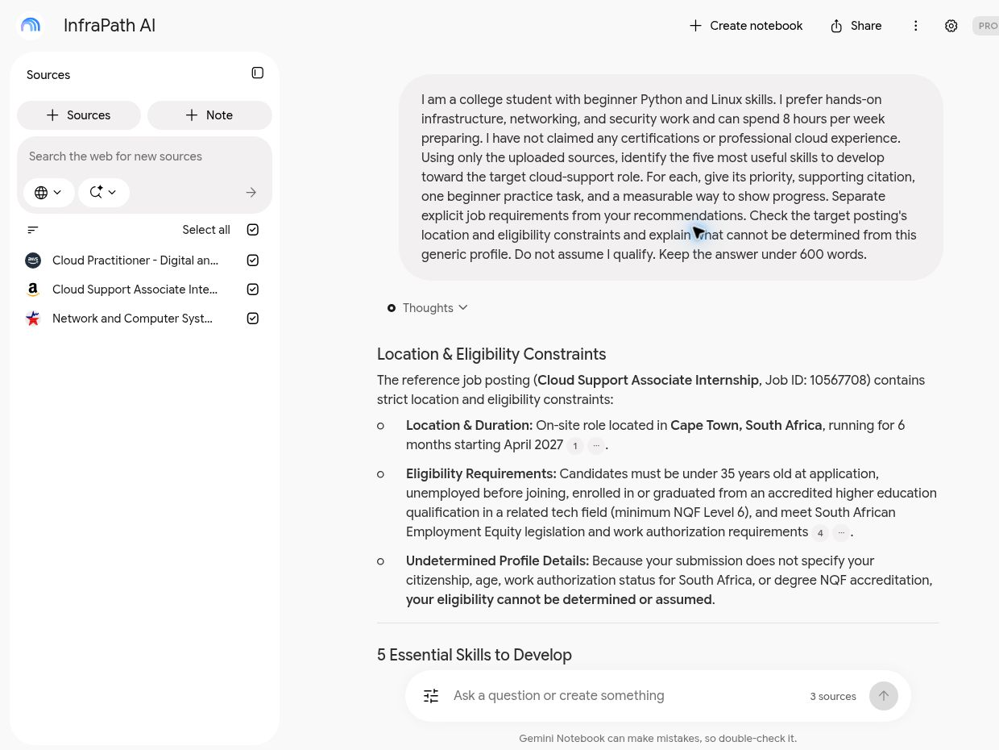
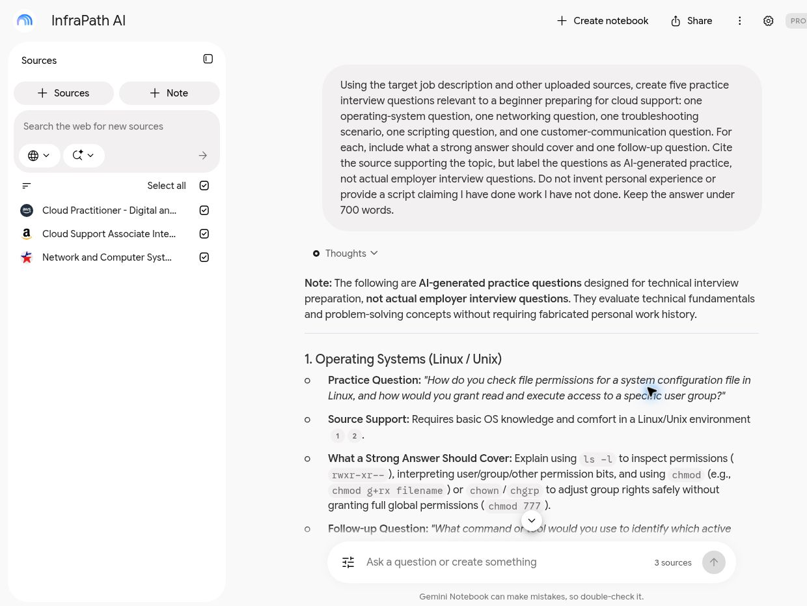
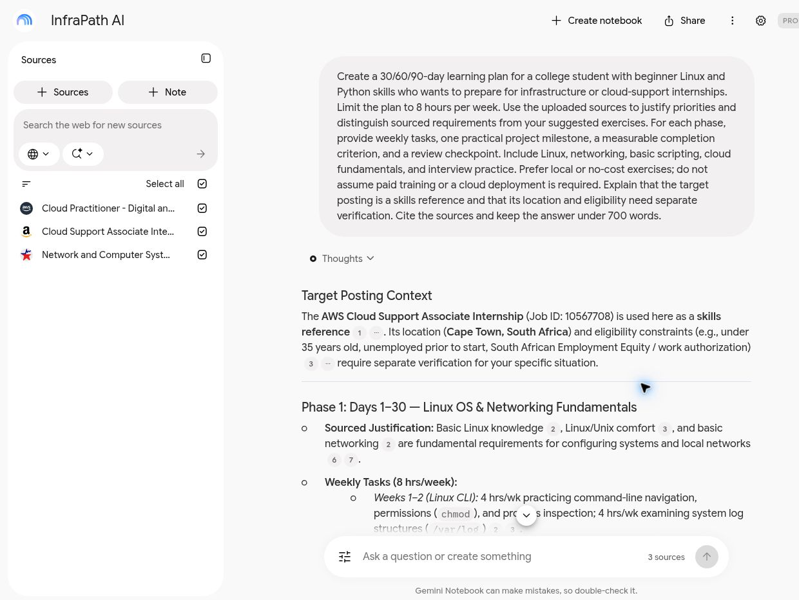

# Meet InfraPath AI

**A source-grounded career coach for students exploring cloud infrastructure, Linux, networking, and security.**

**Career pathway:** IT / Cloud Infrastructure / Cybersecurity  
**Built with:** Google NotebookLM  
**Evidence:** Three completed prompt tests, a baseline comparison, and three privacy-reviewed screenshots.

## Project Overview

The personal NotebookLM notebook is private. Its link and full conversation history are excluded from this public case study.

InfraPath AI is designed as a private NotebookLM notebook that uses curated career resources to help college students understand technical roles, prepare for interviews, and turn broad career goals into practical steps. Its public documentation explains the workflow without exposing personal notebook contents.

## Problem and Goal

Students can struggle to connect broad job descriptions with specific skills they can practice. InfraPath AI aims to identify priorities, explain requirements in plain language, and produce a manageable 30/60/90-day plan. The focus is hands-on infrastructure and security, including the scripting those roles require.

Success means that recommendations cite relevant sources, interview practice reflects the target role, and each action-plan milestone produces evidence of learning. It does not mean guaranteed employment or eligibility for a particular posting.

## Tools and Sources

Tools: NotebookLM for source-grounded conversations; GitHub and Markdown for public documentation; screenshots for evidence of actual tests.

Sources reviewed November 3, 2026:

| ID | Credible source | Purpose |
| --- | --- | --- |
| S1 | [Amazon: Cloud Support Associate Internship, April 2027, Job 10567708](https://www.amazon.jobs/en/jobs/10567708/cloud-support-associate-internship-april-2027-start-support-engineering) | Target job description: operating systems, networking, scripting, and customer troubleshooting. |
| S2 | [U.S. Bureau of Labor Statistics: Network and Computer Systems Administrators](https://www.bls.gov/ooh/Computer-and-Information-Technology/Network-and-computer-systems-administrators.htm) | Broader occupational context and responsibilities. |
| S3 | [AWS: Cloud Practitioner training](https://aws.amazon.com/training/learn-about/cloud-practitioner/) | Official beginner learning path for cloud foundations. |

The three original source links were rechecked for this publication on November 5, 2026. An additional [Amazon technical interview preparation guide](https://www.amazon.jobs/content/en/how-we-hire/university/additional-tech) is provided for future practice. It recommends reviewing the job description and using structured behavioral examples; it was **not** part of the three-source notebook tests. Its role-specific interview format should not be assumed to apply to cloud support.

**Target-role limitation:** S1 is an onsite Cape Town, South Africa internship with location-specific eligibility requirements. It is a learning reference, not a claim that the student qualifies or should apply. It includes Python or shell scripting among relevant skills. Certification is described as preferred, not a universal requirement for cloud careers. Job availability and requirements can change.

## How It Works

1. Create a private NotebookLM notebook called **InfraPath AI**.
2. Add S1, S2, and S3 using their URLs. Confirm each source imports successfully; if an import fails, use a permitted copy of the source text and preserve its title and URL.
3. Add the coach instructions from [PROMPTS.md](PROMPTS.md).
4. Run the career-guidance, interview-preparation, and 30/60/90-day prompts separately.
5. Open citations and compare key claims with the original sources. Mark advice that is an inference.
6. Capture and review three authentic screenshots. Keep the notebook private and publish only reviewed documentation and screenshots.

## Examples and Screenshots

The exact prompts are in [PROMPTS.md](PROMPTS.md). All three were run in the private notebook on November 3, 2026. Screenshots show the submitted prompt and a readable excerpt of the actual output; they are not full transcripts.

| Test | Intended evidence | Status |
| --- | --- | --- |
| Career guidance | `screenshots/01-career-guidance.jpg`: prompt, priorities, and citations | Completed |
| Interview preparation | `screenshots/02-interview-preparation.jpg`: prompt, questions, and answer criteria | Completed |
| Action plan | `screenshots/03-action-plan.jpg`: prompt and measurable 30/60/90-day milestones | Completed |

**Career-guidance prompt:** “I am a college student with beginner Python and Linux skills. I prefer hands-on infrastructure, networking, and security work and can spend 8 hours per week preparing. I have not claimed any certifications or professional cloud experience. Using only the uploaded sources, identify the five most useful skills to develop toward the target cloud-support role. For each, give its priority, supporting citation, one beginner practice task, and a measurable way to show progress. Separate explicit job requirements from your recommendations. Check the target posting's location and eligibility constraints and explain what cannot be determined from this generic profile. Do not assume I qualify. Keep the answer under 600 words.”

**What the test showed:** The response identified location and eligibility constraints before presenting skill priorities. The full test review found that specific practice tasks made the guidance easier to act on, while the screenshot captures the eligibility excerpt.

**Interview-preparation prompt:** “Using the target job description and other uploaded sources, create five practice interview questions relevant to a beginner preparing for cloud support: one operating-system question, one networking question, one troubleshooting scenario, one scripting question, and one customer-communication question. For each, include what a strong answer should cover and one follow-up question. Cite the source supporting the topic, but label the questions as AI-generated practice, not actual employer interview questions. Do not invent personal experience or provide a script claiming I have done work I have not done. Keep the answer under 700 words.”

**What the test showed:** The response labeled the questions as generated practice and paired a Linux permissions question with answer criteria. This made the expected reasoning clearer without claiming access to actual employer questions or inventing work experience.

**Action-plan prompt:** “Create a 30/60/90-day learning plan for a college student with beginner Linux and Python skills who wants to prepare for infrastructure or cloud-support internships. Limit the plan to 8 hours per week. Use the uploaded sources to justify priorities and distinguish sourced requirements from your suggested exercises. For each phase, provide weekly tasks, one practical project milestone, a measurable completion criterion, and a review checkpoint. Include Linux, networking, basic scripting, cloud fundamentals, and interview practice. Prefer local or no-cost exercises; do not assume paid training or a cloud deployment is required. Explain that the target posting is a skills reference and that its location and eligibility need separate verification. Cite the sources and keep the answer under 700 words.”

**Next steps from the test:** Start with local Linux and networking practice, then add scripting and interview explanations. Track deliverables at each checkpoint; these are proposed learning activities, not completed achievements.

The account area was excluded from the captures. No personal resume, transcript, or contact information was included.

## Testing and Improvements

**Original prompt:** “How can I get a cloud internship?”

**Revised prompt:** Test 1 in [PROMPTS.md](PROMPTS.md) adds a beginner profile, a weekly time budget, ranked skills, evidence requirements, source citations, and an eligibility check.

**Observed improvement:** The broad prompt returned a general requirements overview and preparation suggestions. The revised version organized five priorities into practice tasks and measurable outcomes, including a concrete Linux task count and documented troubleshooting cases. Both versions included citations and location cautions, so those are not claimed as new improvements.

**Remaining limitations:** The responses were lengthy. The revised guidance attached citations to some invented exercises before labeling them as recommendations at the end. Citations support the skill topics, not the exact exercises. See [TESTING.md](TESTING.md) for the actual evaluation.

Tests were reviewed for role relevance, citation support, feasibility, and uncertainty. The interview response supplied all five requested categories and explicitly labeled its questions as generated practice. The action plan allocated 8 hours per week and included milestones and review checkpoints.

## Responsible AI

**Source check completed during preparation:** The target posting was checked directly. Its Cape Town location and local eligibility rules mean that a skills match alone cannot establish eligibility. Its certification preference must not become a claim that certification is mandatory for every cloud role.

**NotebookLM response check completed:** Opened citation 1 in the scripting interview section. The citation panel displayed the original basic-qualification section, including basic scripting knowledge and the Python/shell examples. This supports the topic, while the log-analysis question is a generated exercise. The notebook sharing panel was also checked: access was Restricted, with only the owner listed.

**Correction noted:** The posting mixes completed-qualification language in its description with enrolled-or-graduated language in its basic qualifications. The AI should flag that ambiguity rather than resolve eligibility on its own. Work-authorization details also need direct employer verification.

Additional safeguards:

- Do not upload private resumes, transcripts, contact details, credentials, or confidential materials to the public repository.
- Use only a generic student profile in examples; do not invent credentials or experience.
- Treat AI guidance as a planning aid. Verify job requirements and learning costs directly.
- Do not infer suitability from protected personal traits or promise hiring outcomes.
- Keep personal NotebookLM notebooks private and review every screenshot before publication.

## Career Action Plan

The tested NotebookLM plan followed the three phases below. This compact version preserves the proposed learning sequence and adds a final six-day review because twelve weeks cover 84 days. Milestones are suggested learning goals, not employer requirements. Budget: approximately 8 hours per week.

| Period | Work | Measurable deliverable |
| --- | --- | --- |
| Days 1–30 | Practice Linux permissions, processes, logs, and networking diagnostics in a local lab. | Local Linux environment, a 15-command practice check, and a Day 30 explanation of DNS and troubleshooting. |
| Days 31–60 | Practice Python log analysis and Bash health checks with error handling. | Local log analyzer and a Day 60 walkthrough of its logic. |
| Days 61–90 | Study cloud foundations and practice technical and customer-support explanations. Use Days 85–90 to review gaps. | Five documented practice scenarios and one recorded mock interview. |

The generated plan split each week into two blocks totaling 8 hours. Its specific performance targets and assessment threshold are suggestions rather than validated hiring benchmarks. Verify current course access and pricing before enrolling; no paid deployment is necessary for the local lab.

## Reflection

1. **Most useful result:** Turning broad career advice into tasks with an eight-hour weekly budget and measurable checkpoints made the plan easier to evaluate and follow.
2. **Limitation discovered:** Citations sometimes appeared beside generated exercises. A source supporting Linux knowledge does not establish that an employer requires a particular exercise or task count.
3. **Real-job value:** The same workflow could help someone structure learning for a support role, practice explaining a troubleshooting process, and identify questions to verify with a recruiter. It cannot determine hiring eligibility or replace technical documentation.
4. **Future improvement:** Add a relevant local internship description, official technical references, and a progress log. Retest whether each recommendation is labeled clearly and whether the shorter outputs still preserve source support.

This reflection describes the project evaluation; it does not claim the proposed learning plan has already been completed.

## Skills Demonstrated

- Prompt engineering and iterative improvement
- AI output evaluation and citation checks
- Research and source curation
- Responsible AI and screenshot privacy review
- GitHub and Markdown documentation
- Career planning and interview readiness

---

See [TESTING.md](TESTING.md) for the evaluation record and [SETUP.md](SETUP.md) for the completion checklist.
